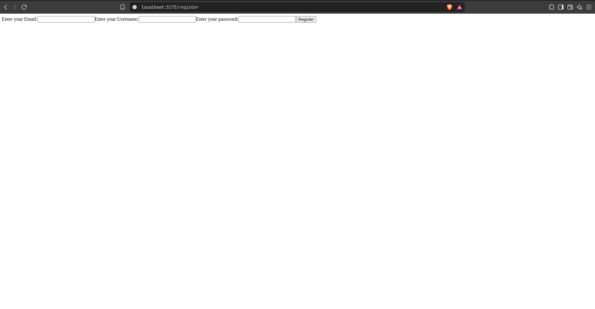
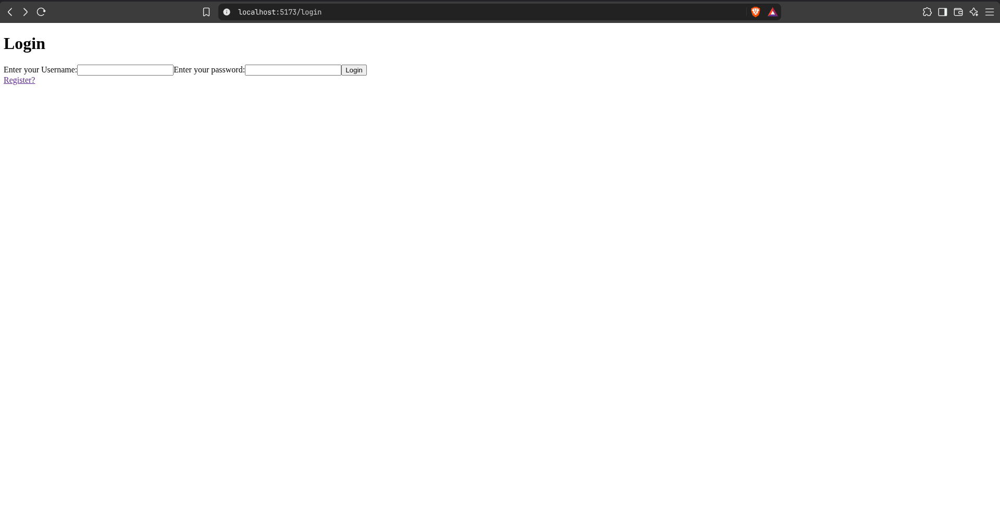
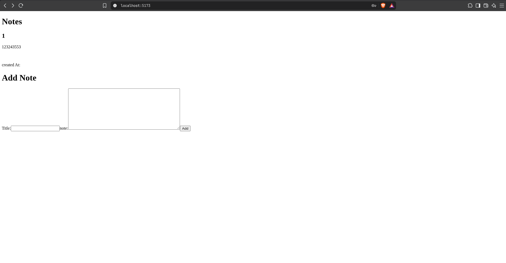
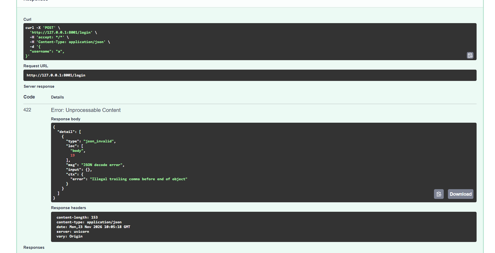
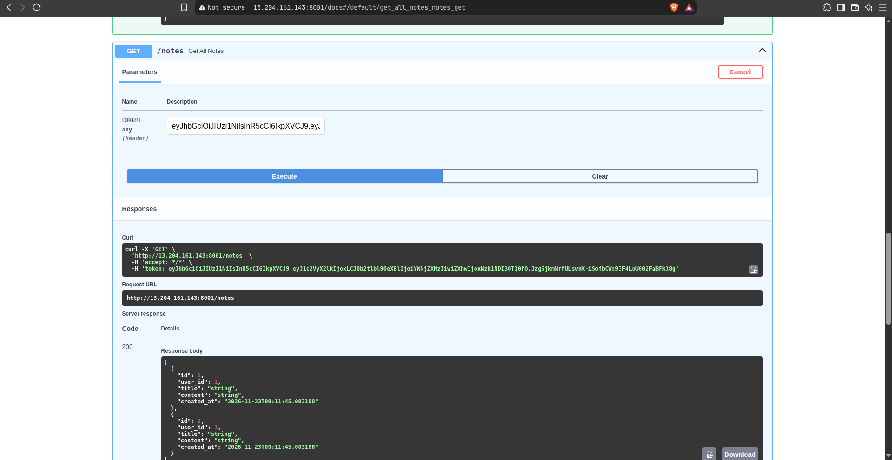
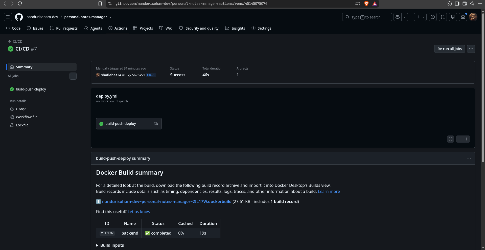

# Personal Notes Manager

## 1. Project and Team

* **Project Name:** Personal Notes Manager

* **Team Members & Responsibilities:**

  * **Soham Nanduri:** Database table creation (`backend/functions.py`), Dockerization (`backend/dockerfile`), CI/CD workflow (`.github/workflows/deploy.yml`), and AWS EC2 management.

  * **Sarang Thilakan:** Authentication endpoints (`A1` - Register, `A2` - Login, `A3` - Refresh Token).

  * **Shafi:** Notes endpoints (`E1` - Get Notes, `E2` - Create Note) and React frontend (`frontend/`).

## 2. Live App

* **EC2 Public Link:** `http://13.204.161.143:8001/docs#/`

## 3. How to Run It

### Backend (Python + SQLite)

```
# Navigate to the backend directory
cd backend

# Create and activate a virtual environment
python -m venv venv
source venv/bin/activate        # On Windows use: venv\Scripts\activate

# Install dependencies
pip install -r requirements.txt

# Run the FastAPI server on port 8001
uvicorn main:app --host 127.0.0.1 --port 8001 --reload

```

### Frontend (React + Vite)

```
# Navigate to the frontend directory
cd frontend

# Install dependencies
npm install

# Start the development server
npm run dev

```

### Docker Container

```
# Navigate to the backend directory where the dockerfile is located
cd backend

# Build the Docker image
docker build -t personal-notes-manager -f dockerfile .

# Run the container mapping port 8001
docker run -d -p 8001:8001 --name notes-app personal-notes-manager

```

## 4. API Contract

### Endpoints Table

| \# | What it does | Method | Path | Request Body / Auth | Success Code | 
| ----- | ----- | ----- | ----- | ----- | ----- | 
| **A1** | Register new user | `POST` | `/register` | `{"username": "", "email": "", "password": ""}` | `201` | 
| **A2** | Login and generate JWT access and refresh token | `POST` | `/login` | `{"username": "", "password": ""}` *(or email)* | `200` | 
| **A3** | Generate new access token using refresh token | `POST` | `/refresh` | `access_token` / Refresh token | `201` | 
| **E1** | Get all notes belonging to logged-in user | `GET` | `/notes` | `access_token` (Auth Header) | `200` | 
| **E2** | Create new note and associate it with logged-in user | `POST` | `/notes` | `access_token` + Note JSON body | `200` | 

### Error Rules Table

| Status Code | Error Type | Condition / Rule | 
| ----- | ----- | ----- | 
| **401** | Restricted Action / Unauthorized | Incorrect email or password, invalid or expired token (access/refresh), or accessing notes without authentication. | 
| **409** | Conflict | Registering with an email that already exists in the database. | 
| **422** | Unprocessable Entity | Missing or empty required fields, or invalid email format. | 

## 5. Database

* **Engine Used:** SQLite

* **Database Name:** `notes`

* **File:** `notes.db` (initialized in `backend/functions.py`)

### `users` Table

| Column | Datatype | Constraint / Info | 
| ----- | ----- | ----- | 
| `id` | Integer | Primary Key (`Unique` + `Not null`) | 
| `username` | String | — | 
| `email` | String | — | 
| `hashed_password` | String | — | 
| `created_at` | Datetime | `Default = sysdate` | 

### `notes` Table

| Column | Datatype | Constraint / Info | 
| ----- | ----- | ----- | 
| `id` | Integer | Primary Key | 
| `user_id` | Integer | Foreign Key referencing `users(id)` | 
| `title` | String | — | 
| `content` | String | — | 
| `created_at` | Datetime | `Default = sysdate` | 

## 6. Screenshots


User registration page connected to `POST /register`.


User login page generating JWT access and refresh tokens via `POST /login`.


Authenticated personal notes dashboard displaying notes belonging exclusively to the logged-in user.


Validation/authentication error handling displayed on the UI (`401` / `409` / `422`).


Endpoint tested and returning a valid response inside FastAPI `/docs`.


Green CI/CD workflow execution in GitHub Actions (`.github/workflows/deploy.yml`).